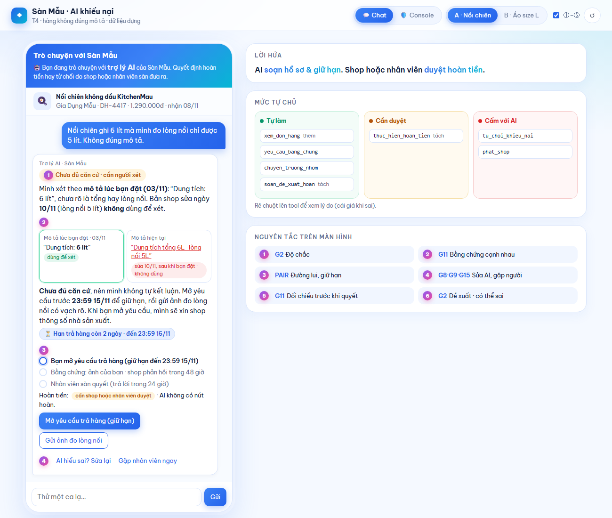
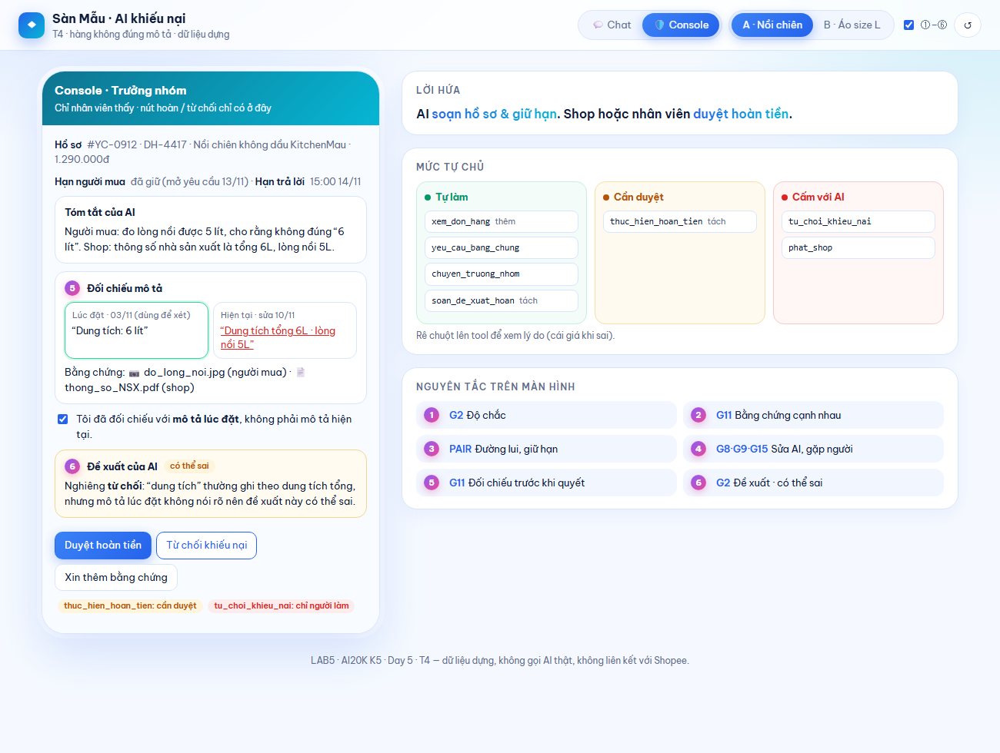

# Prototype T4: Trò chuyện với Sàn Mẫu, "hàng không đúng mô tả"

- **File:** `index.html`, một file HTML duy nhất. Mở bằng trình duyệt, không cần cài gì.
- **Công cụ:** HTML/JS viết tay, có hỗ trợ của coding agent.
- **Phần mock:** mọi đơn hàng, shop, chính sách và câu trả lời của AI đều viết sẵn theo `spec.md` §3. Không có backend, **không có lời gọi AI thật**, không gửi dữ liệu đi đâu.
- **Mở thẳng Màn 2 khi hồ sơ ca A đã đủ bằng chứng:** `index.html#console`.

## Cách bấm qua ca khó (demo khoảng 4 phút)

**Ca A: nồi chiên "6 lít", mô tả đã bị shop sửa sau khi bán**
1. Tab **💬 Chat** (Màn 1) → chọn **A · Nồi chiên**. Đọc nhãn ①, thẻ so sánh mô tả ② và thanh trạng thái ③.
2. Bấm **"Mở yêu cầu trả hàng (giữ hạn)"**. AI tự gửi mẫu xin bằng chứng cho shop, có nhãn "AI đã tự gửi". Hoàn tiền vẫn ở trạng thái "cần duyệt", không có nút.
3. Bấm **"Gửi ảnh đo lòng nồi"**, rồi **"⏩ Shop phản hồi"** (nút trong khung DEMO). Khi đủ bằng chứng hai bên, AI tự chuyển hồ sơ cho trưởng nhóm.
4. Bấm **"Mở Console →"** (Màn 2). Tick ô "đã đối chiếu mô tả lúc đặt" để mở khoá nút, rồi chọn Duyệt hoàn / Từ chối / Xin thêm bằng chứng.
5. Bấm **"← Về chat người mua"** để xem kết quả nhân viên gửi cho người mua.

**Ca B: áo tem L, người bán đúng.** Chọn ca B, nhập số đo vòng ngực. Dưới 98 cm thì AI báo đã đủ căn cứ và hiện nút "Mở yêu cầu trả hàng" để **người mua tự bấm**; sau đó AI mới tự gửi mẫu xin bằng chứng cho shop. Từ 98 cm trở lên thì khiếu nại vẫn mở, AI không từ chối. Sau khi mở yêu cầu: bấm "⏩ Shop phản hồi" → "Mở Console →" để nhân viên duyệt, từ chối hoặc xin thêm ảnh, giống ca A. Bấm "Gặp nhân viên ngay" ở bất kỳ lúc nào thì hồ sơ cũng hiện trên Màn 2.

**Ca lạ:** gõ vào ô dưới khung chat. Prototype nhận các loại: lời doạ bóc phốt, xin số điện thoại shop, nghi hàng giả hoặc đòi khoá shop, người tự xưng nhân viên, đòi hoàn ngay, hỏi hạn. Tin không khớp loại nào thì AI hỏi lại một câu (đơn nào, sai ở điểm nào), kèm nút gặp nhân viên.

**Ngoài ra:** nút "AI hiểu sai? Sửa lại" ④ và "Gặp nhân viên ngay" ④ luôn có trong câu trả lời của AI.

## Ảnh đánh số

| Màn 1 · Chat người mua (ca A) | Màn 2 · Console trưởng nhóm |
|---|---|
|  |  |

| Số | Thể hiện gì | HAX/PAIR | Mức tự chủ |
|---|---|---|---|
| ① | Nhãn độ chắc ở đầu câu trả lời ("Chưa đủ căn cứ · cần người xét") | G2 | — |
| ② | Thẻ so sánh mô tả lúc đặt (dùng để xét) và mô tả hiện tại (sửa 10/11, không dùng) | G11 · PAIR Explainability + Trust | `xem_don_hang`: tự làm |
| ③ | Thanh trạng thái 3 bước + chip hạn đã giữ. Dòng "Hoàn tiền: cần shop hoặc nhân viên duyệt · AI không có nút hoàn" | PAIR Errors + Graceful Failure | `yeu_cau_bang_chung`: tự làm · `thuc_hien_hoan_tien`: cần duyệt |
| ④ | Nút "AI hiểu sai? Sửa lại" (chọn sai ở điểm nào) và "Gặp nhân viên ngay" | G9 · G8 · G15 | `chuyen_truong_nhom`: tự làm |
| ⑤ | Console: phải tick "đã đối chiếu mô tả lúc đặt" thì mới mở được nút quyết định | G11 | `thuc_hien_hoan_tien`: cần duyệt · `tu_choi_khieu_nai`: chỉ người làm |
| ⑥ | Đề xuất của AI (một câu, nhãn "có thể sai"), chỉ hiện sau khi tick đối chiếu | G2 · G11 · giảm anchoring | luật ở `spec.md` §4 |

Cột phải của cả hai màn: lời hứa với người mua, mức tự chủ của 7 tool chia 3 cột (rê chuột lên tool để xem lý do) và chú thích ①–⑥. Công tắc **①–⑥** trên thanh trên cùng bật/tắt các số; nút **↺** làm lại ca.
